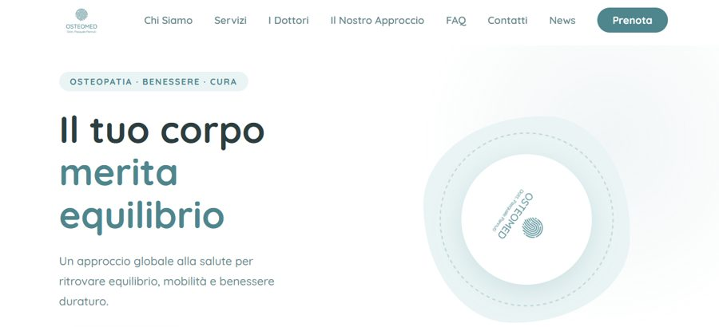
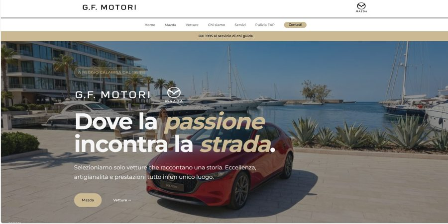
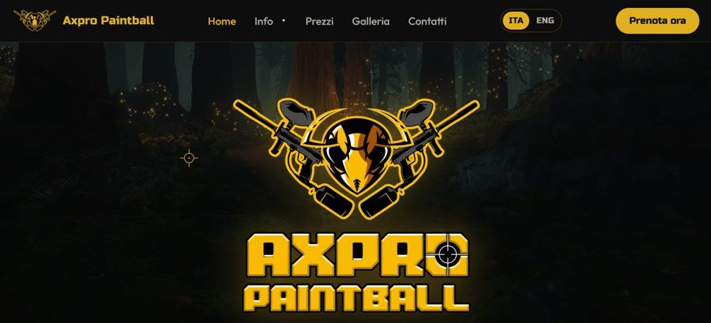
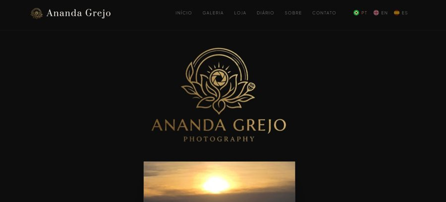
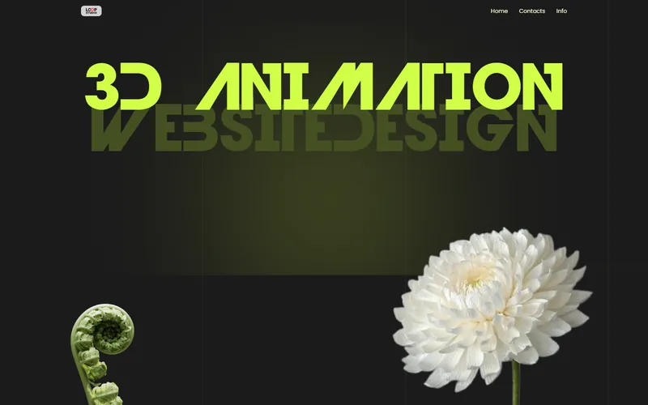
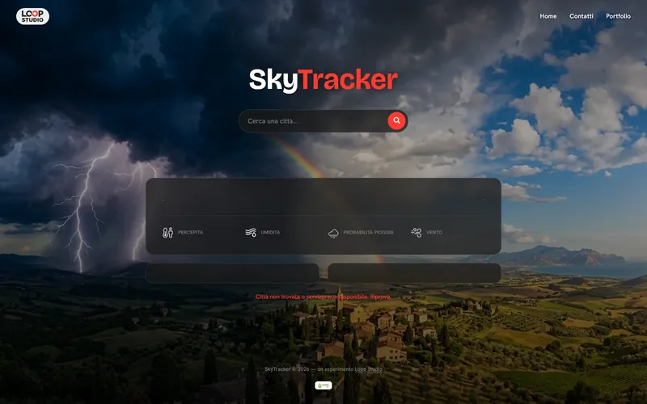
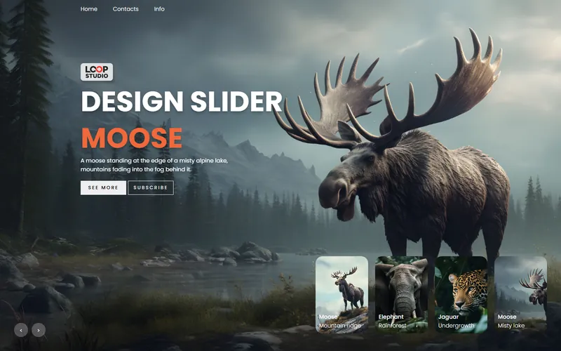

 

**I build websites at [Loop Studio](https://theloopstudio.org). This is where I play.**

  

🇮🇹 *Sono un web developer italiano. I siti veri li faccio con lo studio; qui ci sono i miei esperimenti e la strada che mi ha portato fin qui.*

 

## About me

I started in February 2024 with one line of Java and a hello-world, then followed a 400-hour Full Stack Developer course (HTML, CSS, Bootstrap, JavaScript, PHP, Laravel, agile methods), finished in April 2025. After that I kept going on my own: a lot of React, then Astro, WebGL and real client sites.

Today I design and build the web side of [Loop Studio](https://theloopstudio.org): fast static sites, accessible, measured with Lighthouse, and a lab where I try the things I'm not ready to put in front of a client yet.

**The map of all of it** is my [personal page](https://domenico85.github.io/Domenico/): a constellation where every star is a repository, and a scroll story that changes technique at every chapter (bare HTML, terminal, CSS collage, React, Astro and hand-written WebGL). It's the one place where I don't care about PageSpeed scores, so I push it as far as I can.

## What I work with

<table>
  <tr>
    <td width="33%" valign="top">
      <h4>Sites</h4>
      Astro and static sites, WordPress/PHP when the client needs it, Sanity as a headless CMS. Performance and accessibility checked, not assumed.
    </td>
    <td width="33%" valign="top">
      <h4>Interfaces</h4>
      React and Vite, modern CSS, GSAP and ScrollTrigger for motion, always with <code>prefers-reduced-motion</code> in mind.
    </td>
    <td width="33%" valign="top">
      <h4>Experiments</h4>
      Hand-written WebGL2 shaders, Three.js, scroll-driven stories. Mostly in the Lab, sometimes just for fun.
    </td>
  </tr>
</table>

## Live sites

Real businesses, online today. I built them at [Loop Studio](https://theloopstudio.org).

<table>
  <tr>
    <td width="50%" valign="top" align="center">
       
      <b>Osteomed</b> 
      An osteopathy studio. WordPress, PHP.
    </td>
    <td width="50%" valign="top" align="center">
       
      <b>G.F. Motori</b> 
      A car dealership with its vehicle catalogue. WordPress, PHP.
    </td>
  </tr>
  <tr>
    <td width="50%" valign="top" align="center">
       
      <b>Axpro Paintball</b> 
      A paintball field, with online booking. Astro.
    </td>
    <td width="50%" valign="top" align="center">
       
      <b>Ananda Grejo</b> 
      A photographer's portfolio. Astro, Sanity.
    </td>
  </tr>
</table>

## From the Lab

Experiments I built to understand how things work, now living in the [Lab](https://loop-studio-web.github.io/lab/) of the studio.

<table>
  <tr>
    <td width="33%" valign="top" align="center">
       
      <b>Three.js animation</b>
    </td>
    <td width="33%" valign="top" align="center">
       
      <b>SkyTracker</b>
    </td>
    <td width="33%" valign="top" align="center">
       
      <b>Animals</b>
    </td>
  </tr>
</table>

## Repositories

A few of the repositories I'm happy to show, mine and the studio's. The older exercises and the client work in progress are private or archived.

| Repository | What it is |
|---|---|
| **[Domenico](https://github.com/Domenico85/Domenico)** | My personal page: Astro, GSAP, hand-written WebGL2. [Live](https://domenico85.github.io/Domenico/) |
| **[lab](https://github.com/Loop-Studio-Web/lab)** | The studio's Lab: 28 components and the experiments above, plain static files you can read. [Live](https://loop-studio-web.github.io/lab/) |
| **[vetrine](https://github.com/Loop-Studio-Web/vetrine)** | Full-page homepage concepts for local businesses, built with Astro. [Live](https://vetrine.theloopstudio.org/) |
| **[Meal-Planner](https://github.com/Domenico85/Meal-Planner)** | A weekly meal planner with shopping list, pantry and budget. React 19, Vite, Tailwind 4. The React project I still like the most. |
| **[React-Rhythm-Sync](https://github.com/Domenico85/React-Rhythm-Sync)** | A minimal music player for your own audio files. React, Vite, Tailwind. |
| **[react-portfolio](https://github.com/Domenico85/react-portfolio)** | An animated developer portfolio. React, Tailwind. |
| **[workout-app](https://github.com/Domenico85/workout-app)** | A workout trainer that switches exercise videos round by round. React, Vite. |
| **[react-music-player](https://github.com/Domenico85/react-music-player)** | One of my first React projects: song search with a tiny Express proxy. |

 

<picture>
  <source media="(prefers-color-scheme: dark)" srcset="assets/logo-on-dark.svg">
  
</picture>

<a href="https://theloopstudio.org">theloopstudio.org</a> &nbsp;·&nbsp; <a href="https://domenico85.github.io/Domenico/">personal page</a> &nbsp;·&nbsp; <a href="https://loop-studio-web.github.io/lab/">Lab</a>

